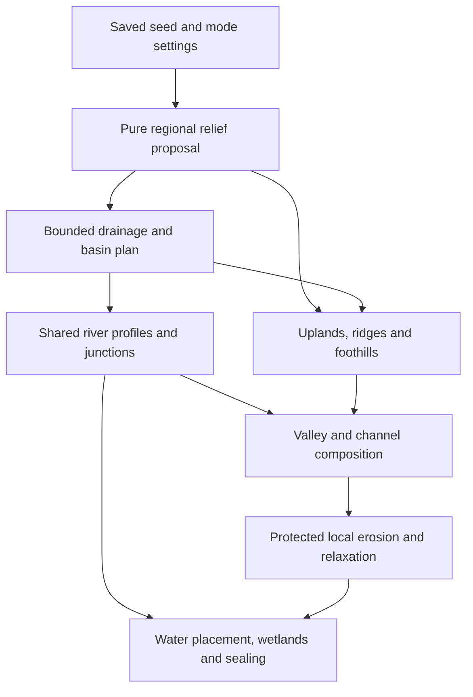

# Rolling Highlands — feature specification

Date: 2026-10-27.
Status: research-backed specification for prototyping; not implemented or world-validated.
Delivery staging: [SCOPE.md](SCOPE.md) and [PLAN.md](PLAN.md). The user selected a playable experimental option first, followed by exploration-led tuning; the full acceptance protocol below remains the eventual release target.
Source baseline: `c5076eb8130a28f10e625ed28d5a9d7aceeb7188`.
Research: [RESEARCH.md](../../research/rolling-highlands/RESEARCH.md).

Algorithm design: [ALGORITHMS.md](../../research/rolling-highlands/ALGORITHMS.md). Internal reuse constraints: [INTERNAL-AUDIT.md](../../research/rolling-highlands/INTERNAL-AUDIT.md). These extend the original research with explicit candidate formulas, a tested interval profile solver and a derived finite domain bound; they do not establish in-game quality.

## 1. Goal and authority

Provide an opt-in FTF generation option, working name **Rolling Highlands**, alongside UPLIFT and MULTI_IMPROVED. Ordinary inland exploration should repeatedly encounter connected mountain systems, rolling uplands, foothills, ridges, passes and substantial valleys. Impressive peaks should rise from varied surrounding relief. Plains remain as selected basins, floodplains and occasional lowland regions.

Rivers organize these forms: tributaries join larger waterways, descend through connected valleys and lower basins, and ultimately reach ocean outlets. Erosion adds branching local detail while preserving broad forms and major peaks. Four controls independently address upland spacing, mountain height, connecting foothill relief and valley width.

**Authority:** the preceding behavior comes from the user's brief. The implementation direction, numeric targets and performance budgets below are research-derived engineering proposals. They are explicitly distinguished from user decisions. The request authorizes producing this specification, not a claim that its proposed defaults have been tested or approved through an interview.

The intended visual comparison is the user's **V3 MULTI_IMPROVED** world. Its exact preset, seed, generator artifact and mod configuration have not been located. It is a pending acceptance fixture, not permission to substitute the current defaults. The current checkout is a separate regression baseline.

## 2. Scope

Included:

- New selectable mode, saved/versioned settings, editor controls and preview.
- Coordinated regional relief, branching mountain systems, foothills, passes, open basins and river valleys.
- Deterministic connected river topology, longitudinal water/bed profiles, confluences, ocean outlets, and any lake/spill behavior required to connect basins.
- Integration with erosion/relaxation, terrain metadata, water placement, wetlands, river sealing and generation caches.
- Fabric and NeoForge validation; fixed-seed aesthetic, numeric, persistence, determinism and performance checks.

Excluded from v1:

- Full tectonic simulation, geologic chronology, rainfall/sediment mass conservation, or runtime fluid simulation replacement.
- A new climate model, biome pack, structure-placement algorithm, cave generator, seasonal hydrology, deltas, or intentionally closed salt basins.
- Retuning existing UPLIFT/MULTI_IMPROVED worlds, rewriting generated chunks, or seamless migration of an existing world's terrain mode.
- A guarantee that every continent size or extreme control combination produces the default exploration experience. All supported combinations must remain finite, deterministic and structurally valid.

New-world terrain naturally changes climate sampling, biome/structure outcomes and cave exposure through existing systems. Those consequences must be inspected, but do not justify rewriting those systems.

## 3. Requirements

### RH-01 — Explicit selection and legacy isolation

- **Current:** ContinentType and the editor expose UPLIFT/MULTI_IMPROVED but no Rolling Highlands mode.
- **Target:** Add serialized `ROLLING_HIGHLANDS`, displayed as Rolling Highlands. It selects coordinated terrain/hydrology behavior. Existing selections, missing new settings on legacy presets, and legacy seed draw sequences retain their original behavior. No automatic mode conversion.
- **Acceptance:** AC-01 checks selection, codec round trips and frozen legacy fixtures before/after the change, including sampled final chunks and water surfaces.

### RH-02 — Three distinct relief scales

- **Current:** Region terrain and a mountain-chain mask are composed separately; UPLIFT uses a broad center-oriented stepped offset.
- **Target:** Generate broad uplands and basins, branching ranges and connecting foothills, then smaller erosion detail. Repeated mountain systems vary in prominence and spacing. Foothills carry relief between major peaks; smaller ridges and passes connect the larger terrain. Repeated identical isolated cones do not satisfy this requirement.
- **Acceptance:** AC-03 measures recurring relief along predetermined routes; AC-04 assesses connected forms in maps, profiles and ground-level views. Turning local erosion off must leave the regional/mountain composition recognizable.

### RH-03 — Deliberate open areas and varied valleys

- **Current:** Terrain selection/border blending can supply low terrain independently of drainage; the shared river carver applies terraced transitions.
- **Target:** Reserve broad dry basins, floodplains and occasional lowland plains. Include both broad buildable valleys and confined mountain passages. Broad floors connect through gradual banks where appropriate. Local cliffs are allowed; widespread elevation shelves and uniformly canyon-like valleys are not.
- **Acceptance:** AC-04 checks floor width/buildability and contrasting valley types, and audits detected long constant-height features. Flat lakes and intentional valley floors are not counted as artificial shelves.

### RH-04 — Connected drainage and explicit outlets

- **Current:** Geometric roots/forks connect without deriving their routes from the terrain or resolving its depressions.
- **Target:** Selected rivers form an acyclic downstream graph with shared confluences. Every generated main river and tributary reaches an ocean, directly or through outlet-connected basins/lakes. Dry local depressions may exist away from the selected network. No river disappears at a chunk, cache, planning-domain or arbitrary rectangle boundary.
- **Acceptance:** AC-05 traverses every network edge in sampled plans, verifies outlet reachability, and checks actual channel continuity at domain and chunk boundaries. Generation cannot satisfy the requirement by generating zero rivers.

### RH-05 — One coherent channel and water profile

- **Current:** Carving and multiple water/surface consumers derive heights from continental water-table steps.
- **Target:** Each junction has one authoritative water elevation. River water profiles never rise downstream; bed stays below water in wet channel sections. Lake surfaces are level and their outlets match the spill elevation. Terrain synthesis, carving, block-water placement, wetlands, sealing, flow vectors and preview read consistent mode-owned information. Non-increasing block levels are allowed; Minecraft's vertical quantization is not a continental shelf.
- **Acceptance:** AC-06 checks mathematical profiles, one-block samples along final channels, generated water blocks and confluences after all filters/features. Float-profile tolerance is 1e-4 block; actual integer water surfaces must have zero downstream rises. Validate model and voxel stages separately.

### RH-06 — Bounded carving and structurally useful erosion

- **Current:** The current carver shapes floors/banks and terracing; the local erosion filter has slope/crest protections but does not establish regional hydrology.
- **Target:** Carving reinforces planned valleys without lowering all rivers to sea level or cutting arbitrary canyons through uplands. Erosion strengthens branching slope detail, preserves the broad relief and main peaks, protects wet-channel continuity, and avoids uniformly sharp noise. Depression-fill surfaces must not be emitted directly as broad visible terraces.
- **Acceptance:** AC-04/07 inspect incision and multiscale before/after profiles. A route/profile with no feasible bounded solution must be revised deterministically or reported as a development failure; it must not silently produce an invalid world or fall back to a legacy river mode.

### RH-07 — Four independent controls

- **Current:** Existing mountain horizontal/vertical/base settings and mountainVariety affect several properties together; valley masks and visible widths are not one quantity.
- **Target:** Implement the control contract in section 4. Changing one control does not secretly alter the others, continent spacing or unrelated global scales. Mountain-height and foothill-relief edits preserve drainage graph topology and horizontal river/ridge skeleton positions; valley-width edits preserve centerlines and longitudinal water profiles. Spacing edits may legitimately change topology.
- **Acceptance:** AC-08 performs independent sweeps, checks saved inputs and intermediate structural outputs, and measures the intended visible response. Natural overlap/headroom limits must be reported, not disguised as parameter independence.

### RH-08 — Persistence, model identity and editor clarity

- **Current:** Preset codecs/copy paths exist; no Rolling Highlands settings/model identity exist.
- **Target:** Save the selected mode, explicit four controls and generation model version in the world-authoritative preset path. Copies are independent. Changing new-world defaults cannot reinterpret existing saved explicit settings. Unsupported model versions and malformed values fail before generation with an actionable message. UI labels specify units/effects; legacy controls superseded by this mode are visibly disabled or clearly mapped.
- **Acceptance:** AC-02/09 cover malformed input, missing fields, boundaries, nonfinite values, import/export, copy/edit isolation, save/reopen and dedicated-server load. Preview updates when relevant inputs change.

### RH-09 — Determinism, ownership and bounded work

- **Current:** Runtime and preview use different cache paths; river state is owned per context.
- **Target:** Output is a function of saved seed/settings/model/coordinates, not exploration order, thread scheduling, cache warmth or preview use. Plans are immutable when published and isolated by owner. Planning has finite node/segment/refinement/concurrency/memory limits; no global world precomputation or unbounded neighbor recursion.
- **Acceptance:** AC-10/11 test reversed/random chunk order, multiple workers, cache eviction/rebuild, two interleaved worlds, simultaneous previews, cancellation, resource release and worst supported settings. No deadlock, timeout fallback terrain, cross-owner leakage, NaN or infinity.

### RH-10 — Preview and final-world agreement

- **Current:** Preview explicitly applies terrain, rivers and climate, with optional filters; final generation also has water/surface work.
- **Target:** Both paths use the same regional plan and water profile. Preview does not generate a simplified alternative river network. Low-resolution display may omit fine gullies, but must preserve landforms, river locations and flow relationships. The actual generated world remains the acceptance authority.
- **Acceptance:** AC-09 compares corresponding coordinates and full-resolution filtered samples. Visual approximation due to zoom is documented; a visually convincing preview cannot substitute for generated-chunk water checks.

### RH-11 — Measurable multiseed improvement

- **Current:** The user's V3 world is the requested comparator; no captured comparison exists.
- **Target:** Demonstrate the desired exploration pattern across fixed seeds without selecting only attractive locations. Preserve occasional plains and dramatic peaks. Record failures and per-seed distributions, not just averages/screenshots.
- **Acceptance:** AC-03/04/12 use the baseline protocol below. A release cannot claim superiority to V3 until the exact V3 configuration has been captured and compared.

## 4. Controls and proposed settings contract

The following values are **prototype starting points**, not experimentally established defaults. Freeze final values after the first FTF comparison pass, and record any changes with before/after evidence. Numeric values are in world blocks; normalized internal height conversions occur at an explicit boundary.

| Saved field | UI meaning | Proposed default and range | Independence contract |
|---|---|---|---|
| `uplandSpacing` | Characteristic distance between regional uplands/basins; not a uniform grid interval | 4096; 1024–16384 blocks | Changes regional wavelength/topology, not amplitude coefficients or ocean/continent scale |
| `mountainHeight` | Characteristic added prominence of major ridges/peaks above their upland surroundings | 160; 32–384 blocks | Alters major mountain amplitude; retains layout and foothill amplitude, subject to documented headroom compression |
| `foothillRelief` | Characteristic amplitude of rolling connectors and lower ridges | 48; 0–128 blocks | Alters connector relief; retains major-peak coefficient and river/ridge layout; zero removes this added component, not all terrain variation |
| `valleyWidth` | Reference **full dry-floor width** for a mature, unconfined valley, excluding banks and wet channel | 256; 64–1024 blocks | Changes lateral floor width with contextual confinement; retains water centerline/profile and channel-width settings |

Additional saved identity: `modelVersion: 1`. Suggested location is an optional `rollingHighlands` object within TerrainSettings; exact class/codec layout is an implementation choice. Mode selection remains in world.continent.continentType.

Missing object on legacy mode: no effect. Missing object on Rolling Highlands: instantiate version-1 defaults and persist explicit values when exporting/creating the world. Present but incomplete object: require modelVersion and all four fields; reject partial/malformed objects instead of mixing implicit defaults into an explicit profile. Unknown versions are errors. Validate both codec and UI; reject out-of-range/nonfinite inputs rather than silently clamping imported presets.

Use world-height-aware validation/headroom handling. The proposed ranges do not imply that every mountain can attain the requested prominence in a short world. Preview must identify headroom limitation; final terrain must remain within build limits without flattened ceiling plateaus. Determine final supported combinations in the prototype before freezing the codec ranges. The uniform-grid planning candidate additionally requires resolution no coarser than uplandSpacing/8 within its node cap; validate continentScale/uplandSpacing combinations rather than claiming the Cartesian product of the slider ranges is supported. See ALGORITHMS section 4 for derived examples.

For this mode, global horizontal/vertical scaling, mountain height/width/base controls and mountainVariety must not apply a second hidden scale to these four controls. Prefer disabling superseded controls while retaining their saved legacy values for mode switching. Existing channel width/depth, continent layout, sea level, world height, climate and local erosion controls keep explicit roles. Audit remaining terrain-region controls: document supported roles or disable them; do not show ineffective sliders as functional.

## 5. Research-derived implementation contract

This section constrains responsibilities, not exact classes or algorithms. See research sections 5–8 for alternatives and rationale.

Required distinctions:

1. **Planning elevation is not visible terrain.** Routing fills/spill levels may guide connectivity, but are not a regional height offset.
2. **All terrain and water share coordinates.** Apply any geometry warp consistently to channels, junctions, valleys and lookup bounds; do not independently warp a tributary away from its parent.
3. **A shared divide has one geometric definition.** Neighboring watershed surfaces cannot assign unrelated heights on either side and rely on a narrow blend to hide cliffs.
4. **Outlets must be real.** Use verified coast outlets or shared boundary connections. A bounded rectangle, chunk edge or cache key is not a hydrological boundary.
5. **Preprocessing uses a pure sampler.** It must not recurse through final terrain/rivers/climate or runtime chunk caches.
6. **Profiles are solved jointly.** Monotonicity, confluence equality, outlet levels, channel depth and incision limits must all hold. A larger downstream cut alone is not an acceptable universal repair.
7. **Water validity is explicit.** Zero is a legitimate ocean-relative elevation; do not use a height value as the sole has-water flag. Use consistent units and separate bed height from water surface.
8. **Final filters cannot break channels.** Protect them or apply a coherent bounded correction after filtering; avoid a second uncontrolled river carving pass.
9. **Spatial lookup includes the full influence.** Bounds/index queries include channel, floor, bank, fade and maximum warp extents, especially at adjacent-domain and chunk edges.
10. **Legacy behavior is selected explicitly.** A new profile must not globally replace ContinentalHydrology for old modes.

## 6. Acceptance protocol

All checks below are implementation work still to be performed. The synthetic probe is research evidence only.

### AC-01 — Legacy regression

Capture fixtures from the unmodified checkout before implementation for UPLIFT and MULTI_IMPROVED, plus smoke coverage for MULTI/SINGLE. Use fixed seeds/coordinates spanning coasts, interiors, rivers, wetlands and negative coordinates. Compare float bits and terrain/water/flow metadata at equivalent cell stages, and representative final chunk height/water/biome outputs. Legacy output must match; build success is not sufficient. New code must not consume legacy random draws.

### AC-02 — Settings contract

Test every field at min/default/max, immediately outside bounds, wrong type, nonfinite inputs where representable, missing object, partial object and unknown version. Assert exact accepted round trips and independent copies. Valid settings must remain finite through all sampled coordinates. Validate limits against supported world heights.

### AC-03 — Repeatable exploration sampling

Development seeds: `0`, `1`, `42`, `8675309`, `-314159`. Add the actual V3 seed when known. These are separate Minecraft worlds, not the synthetic fixture terrain. Hold Minecraft/mod configuration, sea level, world height, unrelated settings and inspection protocol fixed. Compare with the same seed under the captured V3 preset/build; add an optional same-current-build MULTI_IMPROVED control to separate version effects.

Before judging pictures, persist a sample manifest with seed, actual land-domain IDs, coordinates and routes. Select the nearest three suitable land domains in a fixed ordering from a declared origin. Use a fixed spatial search order to locate inland anchors, then eight evenly spaced rays of 8192 blocks, sampled every 16 blocks. Retain rays with at least 75% dry land; do not discard them for being too flat or too steep. If fewer than four qualify per domain, enlarge the domain search using a fixed bounded rule and record exclusions. Insufficient coverage is an inconclusive sample, not a pass. Use default-scale worlds for experience gates; tiny-island settings get structural checks separately.

Proposed default-profile gates, to calibrate once and freeze before release evaluation:

- On at least 75% of eligible routes **within each seed**, encounter at least three distinct ridge/upland rises of 48+ blocks prominence, separated by valley/saddle intervals of at least 128 blocks along the route. Compute on a 128-block-smoothed ground profile; prominence uses neighboring troughs and ignores ocean sections.
- Report median and 90th-percentile longest low-relief run per seed. A low-relief run is contiguous dry-land samples whose centered 256-block ground-height range is under 12 blocks, lasting at least 512 blocks. Tag planned basins/floodplains separately and report both inclusive and untagged results.
- Proposed V3 improvement gate: untagged low-relief-run median decreases by at least 25% in at least four of five seeds; the remaining seed must still satisfy the absolute route criterion. Do not obtain a pass by relabelling all flat land as basin; AC-04 checks those labels geometrically.

These thresholds operationalize the brief; they are not claims about real-world geomorphology or findings of the papers.

### AC-04 — Valley/buildability and landscape review

Per seed inspect at least ten predetermined trunk/tributary cross-sections spread across drainage order and confinement, plus all detected worst incision/shelf cases. Measure perpendicular to the local channel tangent and inspect the final filtered terrain.

Proposed gates for the default profile:

- At least three sampled reaches per seed have a contiguous dry buildable patch at least 64×64 blocks with ground-height range at most 8 blocks. A flooded lake does not count.
- At least two sampled reaches are visibly confined mountain passages; their dry-floor widths are no more than half the median sampled unconfined width.
- Dry open basins/plains occupy a proposed 5–25% of sampled inland area: compute contiguous patches of at least 64×64 blocks with slope below 0.1 block/block and 128-block relief below 12 blocks, excluding wet cells. Report floodplain and non-river lowland contributions separately.
- Identify shelf candidates as connected low-slope patches with height range at most 2 blocks over 256+ blocks of extent and an abrupt adjacent rise. Review terrain profiles and causal fields; planned valley floors/lakes are allowed, unexplained regional terraces and cache-shaped edges fail.
- Review eight ground-level viewpoints per seed selected from fixed route distances, plus four diagnostic worst cases. Confirm connected subsidiary ridges, passes, foothills, broad forms and occasional dramatic peaks. Map labels alone do not prove these forms exist.

Record each rubric item as pass/fail with coordinates and images. User aesthetic review is required to validate the exploration feel; a numeric pass alone is not sufficient.

### AC-05 — Network structure and boundaries

For every generated plan in the sample, independently traverse all downstream links: zero cycles; every selected river reaches a verified ocean outlet through valid connected nodes/lakes; no dangling tributaries or duplicate contradictory junctions. At least one trunk network with two joining tributaries must exist in each sampled default-scale land domain. Check absence of unintended crossings and two unrelated rivers sharing incompatible water columns.

Test actual coastlines, skipped continents, size variance extremes, strongest supported warp, adjacent ownership domains, graph boundaries and short rivers. Force generation from both sides of each boundary first. If some settings do not permit a valid domain, reject them before generation with a specific reason; do not silently route to a fake outlet.

### AC-06 — Water, beds, junctions and voxel continuity

At graph nodes, junctions and one-block intervals along accepted channel paths, verify downstream non-ascent and bed-below-water. Graph samples alone do not cover interpolation or warping failures. Check flat lake surfaces and spill matching, ocean mouth matching, short tributaries and differing branch lengths. Quantized water surfaces may repeat elevations but may not rise downstream.

Generate FULL chunks covering these paths and inspect the final blocks after surface/features: no dry gap, hanging water seam, stone wall across a junction, floating water sheet or unintended basin leak. Verify flow vectors point along the selected downstream branch, including the junction transition. Check after normal nearby water updates, not just immediately after chunk construction.

### AC-07 — Incision and erosion preservation

Store pre-valley, post-valley and post-filter surfaces and distinguish broad basin synthesis from additional channel incision. Both need inspection: changing which stage owns a cut must not hide a canyon.

Proposed default gates:

- In unconfined lowland reaches, 95th-percentile extra channel incision relative to the planned valley floor is at most 16 blocks; ordinary reaches have no unplanned single cut over 48 blocks. Designated mountain gorges may exceed these bounds but occupy at most 10% of sampled channel length and require recorded cross-sections.
- Erosion changes the 512-block-smoothed broad surface by at most 8 blocks at the 95th percentile. Median prominence of the top ten predetermined major peaks per sampled domain stays within 10% of its pre-filter value. Include negative and positive erosion changes.
- Local gully detail is concentrated on suitable slopes, with branching visible in representative views; no equally sharp texture over flat floors. River constraints from AC-06 still hold after filtering.

### AC-08 — Independent control sweeps

With seed and every other input fixed, test each control at min/default/max plus default ±25% where in bounds. Compare diagnostic regional/ridge/river fields and measured landforms.

- Mountain and foothill amplitude sweeps preserve graph topology and horizontal skeleton coordinates exactly. Report peak/foothill response, not global maximum height alone.
- Valley-width sweeps preserve centerlines and longitudinal profiles exactly. Unconfined floor widths must respond monotonically; log confinement/overlap limits that prevent target widths.
- Spacing sweeps alter characteristic regional spacing without altering stored amplitude coefficients. Measure actual prominence distributions to reveal emergent coupling.
- Peak-height response is monotonic on the same identified major peaks until documented headroom limitation; foothill response is monotonic in predetermined connector samples. A zero foothill contribution still retains the underlying regional surface.
- No sweep modifies coast layout or other saved settings. Any requirement relaxation needs an explicit spec revision with evidence.

### AC-09 — UI, preview and persistence

Select mode; inspect units/help; edit four controls; switch away/back; export/import; copy and modify; create world; close/reopen; transfer to a dedicated server. Saved explicit settings/model remain authoritative. Two concurrent previews with different seeds/settings do not contaminate each other. Use identical world coordinates for terrain/river comparisons; preview zoom may change display detail, never network identity.

### AC-10 — Determinism and lifecycle

Use cold/warm/evicted plan caches, reversed and shuffled query order, one and multiple workers, cancel/restart previews, and interleave two worlds with identical coordinates but different seeds/settings. Compare model outputs bit-for-bit within the supported Java/runtime configuration; compare final sampled chunk outputs under fixed mods. Test negative coordinates, origin, integer/block conversions and positions near the supported world boundary. Close owners and confirm resource cleanup.

### AC-11 — Performance and bounded resources

Before production integration, establish and document finite caps for planning nodes/segments, refinement, cache bytes and in-flight builds. Proposed prototype envelope: at most 65,536 coarse nodes per domain, 8 MiB retained plan data per domain, 128 MiB retained plan data per owner, and two concurrent plan builds per owner. Include arrays, graph data and spatial indexes in measurements; account separately for peak scratch memory. Adjust resolution deterministically if necessary and rerun quality checks. An entry-count hint or expiry timer alone is not a memory budget.

Also cap refined geometric/profile samples at a proposed 65,536 per domain; this is separate from the coarse-node count, and both must fit the same byte budget. Reject unsupported resolution/settings combinations explicitly. Refinement cannot grow without bound merely because coarse planning is capped.

On the same recorded machine/JDK/mod set, compare cold and warm generation separately using the existing benchmark tooling, with at least three runs after warm-up. Proposed targets: at least 80% of comparison throughput, warm p95 FULL-chunk latency no more than 1.25× comparison, and p95 cold domain construction no more than 1 second. These are proposed product budgets, not measured performance claims. Record individual maxima, allocations and worst supported settings. If bounds cannot be met without losing required detail, return to domain design before shipping.

### AC-12 — V3 comparison evidence and report

Capture baseline manifest: V3 world path/name, seed, exported effective preset, FTF jar version/hash, source commit if known, Minecraft/loader version, mod list/config hashes, datapacks, sea level, world height and relevant existing chunk coordinates. Preserve the original save; use separate new comparison worlds for additional seeds. Do not generate changed terrain into the baseline save.

Publish per-seed results, fixed routes/views, failed cases, cross-sections, flow checks and timings. Distinguish old-build V3 comparisons from same-current-build controls. Until the exact V3 inputs are available, label results as provisional current-checkout comparisons and leave this criterion pending.

## 7. Edge and failure coverage

This is a manually authored domain-specific edge review, not a claim that the GSD edge-probe engine or a formal interview was run.

| Edge | Required behavior | Verification |
|---|---|---|
| Missing legacy settings vs malformed explicit profile | Legacy unchanged; invalid explicit profile rejected | AC-01/02 |
| Zero foothill relief / extreme spacing / short world | Finite terrain; documented component removal or headroom behavior | AC-02/08 |
| Small islands, skipped continents, all-ocean sampled domain | No invented river/outlet; no stale pooled metadata; structural valid empty plan permitted for non-land | AC-05/10 |
| Inland pit or lake | Explicit spill/routing policy; no unintended land shelf | AC-05/06/07 |
| Tributaries of unequal length and order | Shared water elevation and connected channel geometry | AC-05/06 |
| Conflicting profile/incision constraints | Bounded deterministic revision or diagnostic prototype failure; no invalid publication | AC-05/07/11 |
| Chunk/domain boundary or warp extends influence | Same geometry from either side; complete lookup bounds | AC-05/06/10 |
| Multiple nearby channels | Stable ownership/composition; no incompatible water or accidental crossing | AC-05/06 |
| Post-erosion channel damage / ceiling compression | Re-establish or protect constraints coherently; no flattened peaks | AC-06/07 |
| Cache eviction, concurrent builds, cancelled preview | Identical recomputation, no partial plan exposure/deadlock/leak | AC-10/11 |
| New defaults or unknown model version on load | Explicit saved authority; useful error for unsupported model | AC-02/09 |
| V3 identity unavailable | Honest provisional results, no asserted V3 superiority | AC-12 |

## 8. Readiness and open items

The behavioral requirements are ready for prototype planning. The recommended architecture is supported by source/literature evidence, while the following remain explicitly unproven:

1. **Domain feasibility:** a conservative owner bound has now been derived; actual real-outlet coverage and any shared boundary connections under FTF coast warping still need validation.
2. **Constrained synthesis:** the tree interval solver has passed independent small-case feasibility checks, but the full combination of profiles, basin policies and valley geometry must still preserve broad forms without excessive cutting or shelves, especially at settings extremes.
3. **Default tuning and performance:** proposed numerical values/budgets need FTF measurements and aesthetic review before being frozen as release criteria.
4. **V3 fixture:** exact preset/build/seed/mod context is outstanding; it blocks final comparison, not research or prototype construction.

No numbered GSD phase exists for this feature. The GSD specification format informed this document; phase initialization, scored Socratic interview, automatic edge classification and lifecycle commits were not performed. No interview answers or approvals were invented. Requirements derived from the brief remain distinct from proposed engineering choices throughout.

The next implementation deliverable should be a bounded Java terrain/drainage prototype plus diagnostic maps/profiles demonstrating items 1 and 2, followed by full water/filter integration. Do not start by changing global defaults or replacing the legacy ContinentalHydrology function.

## 9. Algorithm research addendum

The follow-up external/internal research is sufficient to start the bounded prototype described in ALGORITHMS.md. It selects a first-build algorithm for each major stage while preserving the distinction between candidate shape tuning and verified mathematical properties.

Additional implementation constraints from source inspection:

- Convert block offsets with Levels.terrainScaleFactor, not worldHeight. Existing erosion/relaxation assumptions need an RH-specific boundary; global corrections would violate legacy parity.
- Preserve precise world coordinates before the existing float Heightmap boundary; add negative/far-coordinate tests. A double solver cannot recover precision already discarded by a caller.
- Account for preview sample spacing and finite filter support. Zoomed previews are not block-accurate erosion fixtures by default.
- Use explicit mode-aware headroom/compression order. The existing ceiling is tied to mountainVariety and can be applied more than once; wet bed and water constraints must remain coherent.
- Use underlying noise primitives with a single explicit amplitude/scale contract. Complete legacy mountain helpers have additional scaling/terracing/erosion behavior that must not silently compound the new controls.
- Keep profile interpolation linear initially; any smoother replacement must preserve slope, bound, junction and dense channel constraints.
- Handle small level junction cores as shared profile constraints before solving, not as independently carved/warped tributaries. Their appearance and voxel continuity remain prototype tests.

Validation completed for this addendum: 1,000 synthetic tree fixtures matched exhaustive feasibility enumeration; 27 constant-outer-terrain cross-sections passed endpoint/continuity checks. These do not replace any AC group, count as Minecraft seeds, or establish production readiness.
