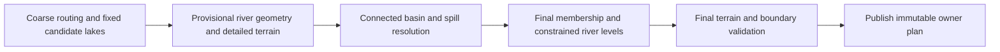

# Plan — resolve lakes against their actual basins

Date: 2026-11-04
Status: implementation retained; 22 targeted regression tests and eight FULL checks passed. Fabric and NeoForge review candidates built. Cold-start performance and full-modpack visual acceptance remain open. Not deployed.
Inputs: [issue spec](SPEC.md), [new research](../../research/raised-lake/FIX-RESEARCH.md), recorded server reproduction.
Current results and limitations: [VERIFICATION.md](VERIFICATION.md).

## Resumed implementation — 2026-11-04

User explicitly authorized continuing beyond the previous failed repair. The implementation now computes feasible
river ceilings before pinning lakes, lowers each affected candidate as a whole, and re-solves its connected footprint
against the same cached terrain evidence. Candidate discovery and river geometry remain fixed. The solver is reused
unchanged; numerical tolerances and existing lake-quality gates have not been relaxed.

Earlier checks before the compatibility run:

- Coarse whole-body constraints: 17 lakes, 0.95 km², mean depth 7.8, shallow share 15%, zero inlet steps.
- One-block edge testing initially exposed 833 dry-bank spills (maximum gap three blocks).
- Full one-block refinement plus compact row-span storage: **32,924 tested dry-bank edges, zero spills**;
  17 lakes, 0.92 km², mean depth 8.1, shallow share 14%, zero inlet steps, zero shore-parallel run.
- All five focused controls passed, including a one-block outlet hidden between coarse samples and exact integer
  membership of a closed bowl. Existing 8 MiB retained-plan budget remains enforced. Dense storage exceeded that
  budget; wet row spans and sparse coarse-node surfaces replaced it instead of raising the budget.
- Evidence: `whole-body-constraints.json` and `fine-resolution-passing.json` under the research directory.

Earlier additional work: bound expensive terrain evaluation to the one-block boundary band; validate final banks
after the last profile change; preserve oxbow/channel provenance to update oxbow water; treat foreign owner domains
as open boundaries. Those additions were subsequently integrated and are covered by the current checkpoint below. The first full-refinement fixture
checks took roughly 154–159 seconds each, so avoiding full-window fine terrain evaluation is necessary.

Reuse remains local because this checkout is untracked by Gortex: existing `TreeProfileSolver`, the range priority-
flood pattern, basin state, and the exact existing land/valley/oxbow stages. No dependencies, serialized options,
new planning framework, server writes or world repair operations have been added.

### Current integration checkpoint

The boundary-only interior approximation was rejected: its clamped coarse depths removed supported bodies.
The current resolver samples **every interior column exactly**, plus a local exterior margin. Unsampled exterior
space is an escape. Coarse and fine windows use row-parallel sampling with the existing per-thread scratch state;
independent windows retain deterministic order and priority-flood tie-breaking. No executor/dependency was added.

- `resolved-lake-gates.json`: nine focused tests passed. Quality: 16 lakes, 0.87 km², mean depth 8.0,
  shallow share 14%, zero stepped inlets or parallel channels. All 32,384 checked dry-bank edges contain water.
- River Count 7 and 3 both retain seven lakes; the unchanged contract passes.
- Concurrent generation, seed isolation and cache rebuilds pass the existing 30-second future timeout.
- Final bank diagnostics found a one-block feedback loop in the River Count 3 preset: lowering lake/river levels
  reopened the same bank one block lower. The planned **maximum two-block residual seal** now applies only to
  immediate dry neighbours; beds never rise. Larger gaps still lower/re-resolve the entire body. A synthetic
  control proves that sealing cannot create the reported tall retaining wall or spread beyond the immediate bank.
- Full-window parallel sampling was correct but slow. Its fixture resolution took 43.25 seconds; after limiting
  only exterior sampling, the combined boundary test takes 15.68 seconds and quality probe 23.98 seconds (different
  workloads, not a direct speed ratio). Full owner timing and FULL-chunk timings are now recorded in VERIFICATION.md.
- Prior failures are retained in `boundary-band-tests.json`, `parallel-full-*.xml` and `row-parallel-*.xml`.
  They are historical failures, not claims that the current gated implementation fails those same checks.

### Historical-layout replay and first FULL results

- `fixed-server/`: the current resolver with c92366ef `HighlandLand` only, the actual saved preset and seed. It
  omits original candidate 4 everywhere in its 1,200-sample positive footprint; all five diagnostic positions
  return their pre-lake ground. Eight supported bodies remain, with no overlapping membership in the replay.
  Retained body data: 389,576 bytes; measured owner-plan wall time: 6,373 ms.
- `full/neoforge-site/` and `full/fabric-site/`: each generated 1,089 FULL chunks covering the report and lower
  stream, then used the existing 40-tick validation delay. Both: 4,393 wet/flow columns, zero missing flow fields,
  zero spills and zero failures. Benchmark chunk-generation times: 34.21 s NeoForge and 29.43 s Fabric. These do
  not include startup/owner-plan work, and are compared with the unmodified generator in VERIFICATION.md. Cold startup is materially slower.
- NeoForge saved-block transects: all 39 former lake surface columns lose the Y=117 sheet, with ground 14–28 blocks
  lower. The two identified lower-stream controls retain ground Y=85/84 and water Y=86 exactly.
- Harness correction: a bare preset pack was overridden by the dedicated-server default export. The opt-in init
  script now selects the saved preset through the existing `DefaultPresetArchive` in the disposable benchmark
  config. Both corrected starts match the saved settings and reported center ground Y=90. Optional codec defaults
  are omitted by export; omitted rangeLength=6144, rangesReplaceMountains=true and snowline=60 retain their values.
- A 2,401-chunk retained-lake run found two validator false positives where solid terracotta replaced planned
  water. Bounded actual block inspection proves the water is separated from the hole by those solid columns.
  `HighlandWorldValidation` was corrected to check actual water/ice boundaries; the complete NeoForge and Fabric runs subsequently passed with zero spills.
  Evidence and exact classification are in `full/neoforge-lake0-first/diagnosis.md`.

### Final implementation checkpoint

- Shore excavation and locally propagated confluence caps repaired two compatibility regressions without weakening
  existing thresholds. Immediate dry lake banks now use the existing erosion-protection flag after a real FULL-block
  ice-edge spill exposed post-filter bank loss. The corresponding test failed before and passes after the repair.
- All 22 distinct targeted regression cases pass across the recorded incremental runs. Both normal loader builds
  succeeded; packaged terrain bytecode was checked against the current normal-source compile.
- The eight latest FULL runs pass: 8,688 chunks, 279,746 wet-column checks, zero missing flow/spills/failures.
  Six historical-layout runs precede only the narrow bank-protection flag; the final two regression areas use it.
- The candidate is not a routine deployment recommendation: the paired cold startup rose from 11.138 to 91.564
  seconds. Full-modpack visual acceptance and any existing-world repair also remain separate.
- Exact evidence, candidate paths/hashes, implementation deviations and the issue-only patch are in
  [VERIFICATION.md](VERIFICATION.md). No remote or saved user world was modified.

## Previous execution result — 2026-11-04

The connected-basin strategy passed the isolated feasibility experiment. The integrated prototype did **not**
pass the river-contact contract, so it was saved as a reviewable
[patch](../../research/raised-lake/resolver-integration-prototype.patch) and removed from production sources.
The pre-existing shoreline and other working-tree changes were restored byte-for-byte from the start-of-attempt snapshots.

| Check actually run | Result |
|---|---|
| Original candidate provenance | Server basin 4 is a kept off-network hollow: all four nodes have `kept=true`, `structural=false`, `drawn=false`. It is not a dam candidate. |
| Dam clamp hypothesis | Sampled accepted dams in both fixture and server plans remain below original ground; their incision is positive. The negative-incision clamp is a latent contract concern, not this incident's cause. |
| Existing lake/profile agreement | No water-level mismatch at the sampled original lake-channel members in either plan. |
| Isolated neutral-ground resolution, fixture | 18 candidates retain a qualifying largest connected body; total area 971,824 m². These are provisional bodies, not final generated lakes. |
| One-block server lake 4 | No qualifying body. Maximum natural retention 1.37335 blocks in the original footprint, below the existing four-block depth policy. |
| One-block server control 11 | A body remains: 25,817 m², mean natural depth 4.12, water Y=97.11964. Original planned water was Y=100.63580. |
| First integrated `HighlandLakeTest` | 17 rendered lakes, 0.95 km², mean depth 6.5; **failed** shallow share (29%) and inlet continuity (29 steps across six lakes). |
| One targeted repair | Extended lake pins over channel width/interpolation contacts and added bounded bed excavation; **failed** profile feasibility at node 7070: lower bound 3.98279493 exceeds upper bound 3.86519558. Heights are relative to the Y=61 datum. |
| Focused containment regressions | All four passed in the repaired prototype: measured bed, measured bank, open slope, enclosed bowl with low terrain outside its divide. |
| Existing profile solver tests | Both passed, including its exhaustive integer oracle. The integration supplied incompatible constraints; no solver defect was demonstrated. |
| Restored production baseline | `HighlandLakeTest` and both `TreeProfileSolverTest` cases passed after restoration. `git diff --check` passed; all three touched production files match their starting snapshots byte-for-byte. |

**Required change identified at that historical checkpoint (now implemented):** compute contact constraints for the whole body before committing its water level and
membership. A stream contact can impose a lower feasible level than the terrain-only spill result. Propagate that
bound to the entire candidate, then re-resolve its connected footprint and contacts with a monotonically decreasing
cap. Do not patch the solver, relax tolerances by 0.12 blocks, move individual lake samples independently, raise the
neighboring stream, or increase the allowed wall height. Quantify convergence and retain infeasibility diagnostics.

The saved prototype is intentionally incomplete: four-block membership only; no final-terrain reconciliation,
one-block production boundary representation, refreshed oxbow profiles, overlap handling, FULL-chunk/fluid checks,
or loader build. Its early whole-window sampler also costs about 43 seconds for 1.75 million fixture terrain
samples; production sampling needs a bounded/coarser search followed by local boundary refinement. These omissions
must be addressed before release, even if the inlet assertion later passes. No server changes were made.

The implementation loop stopped under the mandatory iterative-delivery repair bound after the failed repair.
Detailed outputs: [integration-results.json](../../research/raised-lake/integration-results.json),
[first failure](../../research/raised-lake/integration-first.xml),
[repair failure](../../research/raised-lake/integration-repair.xml),
[fine-grid results](../../research/raised-lake/server-fine/resolution.json),
[restored baseline checks](../../research/raised-lake/integration-restored-tests.json).

## Outcome and recommended approach

Replace forced containment of coarse lake outlines with resolution of connected water bodies on detailed terrain.
Keep a valid lake at its planned level when possible; otherwise shrink/lower its body to a real spill level. Remove
it only when no acceptable basin remains. Then bind its incoming/outgoing river profile to that resolved level.

For the reported site, the sampled ground drains away and retains at most a 1.28-block pocket. The expected fix
is removal of the elevated lake, preserving the lower valley and stream. This is distinct from removing every
lake. The original fixture's 15–27 lake / 0.65–1.6 km² gates remain preservation checks until evidence warrants
an explicit contract decision; they are not automatically relaxed to make a new algorithm pass.

No new library, hydrology framework or whole-world fine grid. Extend the existing basin, drainage and rendering
code. Keep this work isolated from the uncommitted shoreline, biome and climate changes already in the checkout.

## Design decisions

**Decided from evidence**

- A per-column cap or whole-candidate rejection pass is insufficient.
- Lake membership, level, inlet/outlet constraints and rendering must agree.
- Candidate identity must survive changes in enumeration order; use stable seed/owner/original-node provenance,
  not transient basin list indexes alone.
- Freeze candidate discovery during resolution. Do not repeatedly run the full candidate generator and introduce
  replacement dams after rejected candidates release spacing slots.
- A sampled planning/window edge is an escape or an unresolved boundary, never a retaining wall.
- The reported server layout and measured regression must survive future terrain-layout changes in the test fixtures.

**Proposed implementation choices to validate in step 1**

- Local connected flood/spill resolution in existing `HighlandBasins`.
- Start with 4-block terrain samples; refine candidate wet/dry boundaries, spill saddles, narrow necks and river
  joins at one-block spacing. A coarse mask is only a candidate search accelerator, not proof against leaks.
- Serialize no new user option. Retain compact finalized body membership/shore data per owner; prototype row spans
  for the wet boundary before committing a representation. Include its actual bytes in the existing 8 MiB retained
  plan budget. Release temporary flood grids after resolution.
- Reuse `TreeProfileSolver` for constrained final water levels instead of adding a second profile solver.
- Retain two blocks as the maximum small sealing adjustment pending tests; it is a renderer limit, **not** a rule
  that rejects a whole basin at the first low point in its broad shore-influence region.

## Resolution pipeline

The first routing pass is provisional. Resolution needs actual river-valley geometry, so it cannot precede all
river work. It must precede publication of authoritative membership and water profiles. A bounded validation
pass checks the final terrain because updated profiles affect support floors and valley cuts.

### Terrain supplied to the resolver

Factor the existing land → dissection/incision → channel floor → valley carving → oxbow sequence locally from
`groundBeforeTarns`. Accept an explicit provisional index and never look up that index through the owner cache
while it is being built. Preserve the separate cirque-tarn path.

Retain enough pre-lake channel state to evaluate the candidate without crediting support created solely by its
own proposed backwater. Keep unrelated neighboring valleys in the evaluation. Record both the neutral baseline
and the eventual final-profile baseline: suppressing all rivers would hide the reported failure, while counting
the lake's own support as natural containment is circular. Establish this baseline contract in the prototype
before refactoring `HighlandDrainage.build`.

### Body and spill resolution

1. Use the original flooded nodes and recorded candidate type (depression, closed hollow, dammed reach) as seeds.
   Preserve dam location, intended spill receiver and original membership before shore growth/resampling loses it.
2. Sample a local domain containing the candidate and its possible spill paths. Expand deterministically within
   a measured budget if the search reaches an unresolved edge; never accept because a clipped domain appears closed.
3. Compute connected depressions/escape elevations. The reachable component determines which terrain must contain
   the lake. Ignore disconnected low ground beyond a higher divide.
4. Choose the highest contained level no higher than the planned level, with existing freeboard and quantized
   block-water placement considered. Shrink or split membership where raised ground separates the water. Apply
   existing depth/size policy to resulting bodies; no qualifying body means omit the candidate.
5. Treat real river inflows and the intended outlet as openings, not bank failures. Preserve an actual outlet path
   at a compatible level. A dam candidate needs a localized, explicit barrier geometry that passes the same checks;
   it cannot implicitly authorize a high rim around the entire lake.
6. For overlapping candidates, solve the connected group deterministically. Do not publish overlapping columns at
   incompatible water levels or resolve the same terrain differently according to iteration order.

### Final hydrology and terrain

- Feed authoritative body membership and water into `nodeSurface`, shore absorption, axis samples and
  `HighlandMeanders`; clear obsolete memberships and recorded outlets. A changed `Sample` water alone is insufficient.
- Reuse `TreeProfileSolver.solve`: pin all samples belonging to an accepted body with `low == high == water`;
  use zero drop inside that body, existing river slope limits outside, and existing confluence constraints. All
  arrays must have finite limits and parent-before-child ordering. Pin unaffected boundaries when resolving a
  local subnetwork so the solver cannot move unrelated rivers to satisfy a bad lake.
- Treat `Infeasible` as a candidate/connection problem with diagnostics, not as permission to independently lower
  a few lake samples or fall back to a riverless continent. Existing final monotonicity passes must not overwrite
  pinned lake levels afterward.
- Render the resolved connected footprint. Under water, carve with `min(existingGround, desiredBed)`; never raise
  a deep existing bed just to enforce a maximum depth. Outside water, small sealing stays bounded. The renderer
  must not independently reintroduce the old coarse footprint through shoreline advance/noise.
- Reevaluate final terrain near bodies and joins. Any revised profile invalidating a boundary returns the affected
  connected group to reconciliation, with a fixed candidate set and monotonically non-increasing level bounds.
  Establish a small measured iteration/work budget in step 1. Exhaustion is a visible unresolved result during
  implementation/testing; do not ship a silent "remove all lakes" or riverless fallback.

## Execution steps and stop conditions

### 1. Prove the resolver in an isolated prototype

Files: extend the existing research probes under `.planning/research/raised-lake/`; no production change yet.

- Instrument candidate admission provenance and export all original fixture candidates with pre-lake terrain,
  water, footprint, neighboring reaches and intended connections.
- Prototype the connected spill algorithm on those exported fields, using existing Java/Python standard library
  queues. Add synthetic closed bowl, open slope, divided basins, narrow saddle and intentional outlet examples.
- Compare coarse and one-block-refined boundaries at the server lake and representative retained lakes. Report
  per candidate: keep/lower/split/remove, original/resolved area and depth, spill path, maximum terrain fill and reason.
- Measure sampling count, temporary/retained bytes and resolution time. Account for the existing 8 MiB index limit.
- Test the neutral-vs-final river baseline contract and determine the bounded reconciliation budget empirically.

**Exit gate:** reported embankment is eliminated; known supported bowls remain; a realistic set of fixture lakes
survives and the aggregate preservation gates remain achievable. If not, report why before changing production
or weakening tests. This gate subsequently passed; see the resumed implementation and current verification report.

### 2. Retain candidates and integrate one authoritative body representation

Primary files: `HighlandDrainage`, `HighlandBasins`, `RollingHighlandsContinent`, `HighlandPlanIndex`.

- Separate provisional routing/candidate construction from final publication with local helpers/data in the existing
  classes. Retain only the candidate/provisional state demonstrated necessary by step 1; avoid a new planning framework.
- Add the resolved body data and route `sample`/`nodeSurface` through it consistently. No public or serialized API
  expansion beyond what the integration requires.
- Add tests for stable candidate identity, consistent membership and owner-boundary behavior. Preserve baseline
  output for unaffected terrain, using fixed coordinates rather than choosing convenient samples after the change.

**Exit gate:** the same resolved level and membership are observed by all lake consumers; no cache recursion,
unbounded full-continent retry or candidate replacement cascade.

### 3. Bind profiles and replace forced bed/rim fill

Primary files: `HighlandDrainage`, `HighlandMeanders`, `TreeProfileSolver`, `RollingHighlandsContinent`.

- Integrate pinned lake constraints with the existing profile solver and update affected joins/outlets and oxbow
  water consistently. Preserve unaffected branches.
- Apply carving-only bed behavior and bounded small sealing to finalized bodies.
- Promote the frozen bed/bank regressions into normal tests, and add full-body containment tests; those two local
  arithmetic assertions alone cannot prove a lake won't leak.
- Extend `HighlandLakeProbe` with pre/post-lake fill and connected escape diagnostics. Report individual failures
  rather than hiding them in continent-wide averages.

**Exit gate:** server regression, supported-lake controls, no dry/wet seams, one level per lake, bounded fill,
downhill profiles and existing lake/river preservation gates all pass.

### 4. Verify final Minecraft blocks and prepare a reviewable build

- Run `HighlandLakeTest`, containment regressions, `TreeProfileSolverTest`, `HighlandPlannerTest`, relevant
  `HighlandGroundTest`/`HighlandQualityTest`, `HighlandStreamsContractTest`, and owner/cache/concurrency checks in
  `HighlandDeterminismTest`. Use seeds 0, 42 and 8675309 plus the preserved server seed/layout.
- Check River Count and Valley Width contract tests explicitly. Preserve their guarantees unless measured basin
  validity makes that impossible; then obtain a narrow contract decision with evidence before revising the tests.
- Generate fresh FULL chunks in the existing Fabric and NeoForge benchmark harnesses for the reported lake,
  at least two retained lakes, an outlet and a nearby lower stream. Check after normal fluid updates, cave/surface
  and feature passes. Compare ground/water transects and in-game views with the retained evidence.
- Measure generation cost against the same unmodified baseline. Include full resolution work in diagnostics, not
  only `Plan.buildNanos`. Run loader builds after relevant tests pass.
- Review the actual diff, document settings/world compatibility and provide artifacts. The generator change will
  not repair saved server chunks; deployment and any existing-world terrain repair are separate steps.

## Reuse and implementation boundaries

| Needed behavior | Existing implementation | Planned action |
|---|---|---|
| Detailed pre-lake surface | `groundBeforeTarns`, `carveValleys`, `shapeOxbow` | Factor locally and share exact sequence; explicit provisional state |
| Local spill search | `HighlandRangeRelief.fillWindow`, Java `PriorityQueue` | Adapt locally to ordinary basins; no new library/shared generic solver |
| Body bounds/one water level | `HighlandBasins` fields; tarn bounds/water pattern | Extend existing basin state |
| Feasible downhill profile | `TreeProfileSolver.solve` | Reuse with lake pins, finite bounds, infeasibility reporting |
| Membership-driven channel routing | `absorbed`, `HighlandMeanders`, `nodeSurface` | Feed finalized body data, clear stale assignments |
| Real-world regression/measurement | Existing research probes and `HighlandLakeProbe` | Extend and promote focused cases |

Gortex graph verification is unavailable for this untracked checkout; these findings are from permitted local
source searches. There is no approved need for a new dependency, architectural layer or general abstraction.

## Risks and explicit exclusions

- **Preservation:** some current lakes rely on large artificial walls and must change. Do not claim exact retention
  of every lake, or label all lake-count losses legitimate without proving the affected terrain cannot hold water.
- **Sampling:** four-block sampling can miss a one-block saddle/channel; boundary/refinement and final-block checks
  are required. Grid interpolation must not recreate a leak or a rectangular shoreline after resolution.
- **Coupling:** changed water profiles alter carved ground and support floors. Both neutral and final-ground checks
  are necessary; a one-pass provisional calculation is not assumed self-consistent.
- **Ownership/cost:** connected bodies near owner boundaries and very large domains need deterministic boundaries
  and measured budgets, not cache-order-dependent neighbor reads or fine grids for entire continents.
- **Not included:** climate/biome changes, new decorative shore styles, glacier/cirque redesign, full runoff-volume
  simulation, distant-LOD rendering, automatic server deployment or regeneration of existing chunks.
