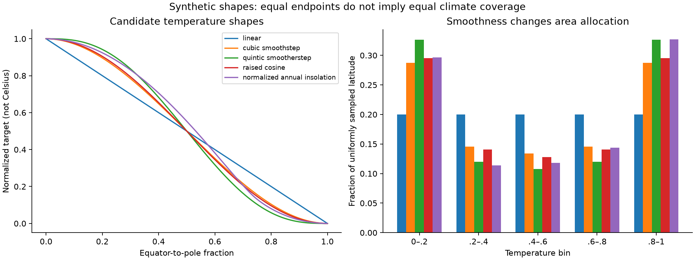
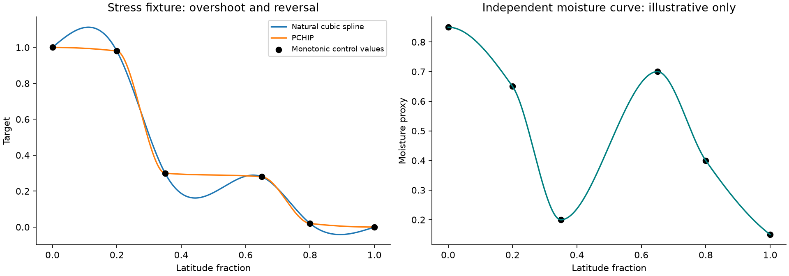
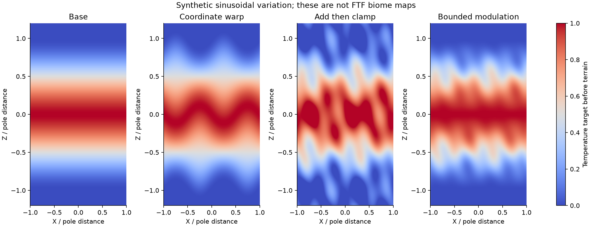
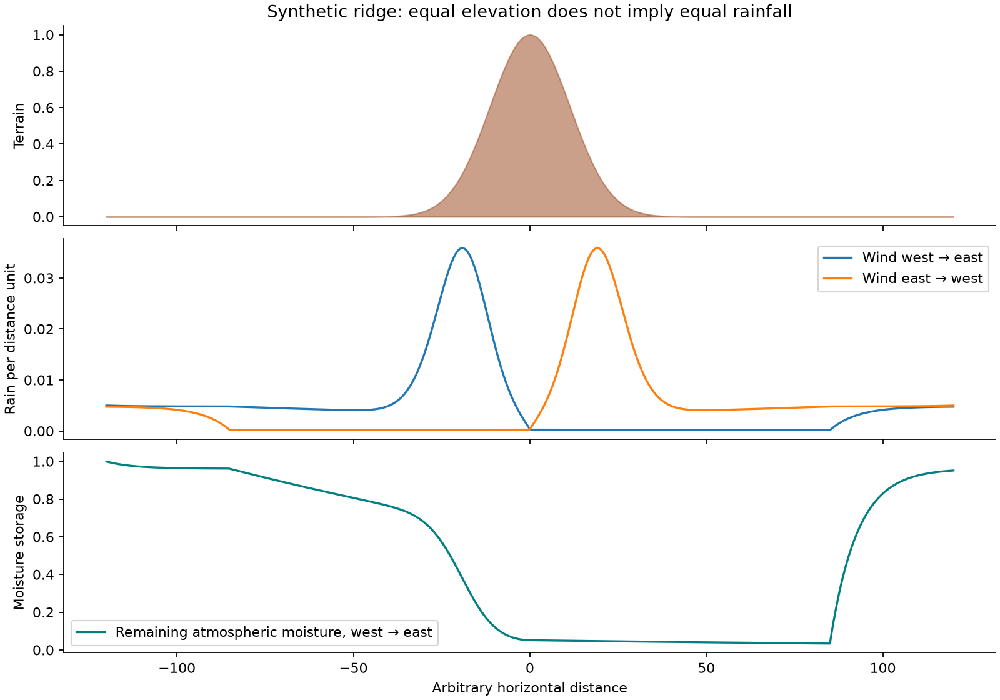

# Algorithm research for native FTF climate

Prepared 2026-10-22. Companion to [the architecture research](RESEARCH.md). This document compares mathematical models, records independent experiments, and narrows implementation choices. It does not introduce a production algorithm or establish compatibility with Natural Temperature (NT).

Subsequent user decision: the [canonical specification](../../features/native-latitude-climate/SPEC.md) includes temperature and independently controlled latitude moisture in the first release. Existing regional moisture and coastal/elevation shaping remain in place. The staging suggestions below are research recommendations, superseded by that selected scope.

## Findings and recommended direction

Use a layered deterministic climate field: geographic temperature, retained regional variation, and FTF's existing terrain correction. Treat moisture as a separately designed field. Keep costly ocean/wind/terrain transport outside the first PR until its input ownership and tile-boundary behavior are solved.

The initial smoothstep proposal remains a useful baseline, but it is **not a settled winning algorithm**. Compare cubic smoothstep with a raised cosine against real biome coverage. If configurable climate zones are needed, use a shape-preserving Hermite curve with validated control points. Do not adopt a more complex solver merely because it sounds more realistic.

The experiments found that smoother curves allocate more area to endpoint climates, unrestricted cubic splines can reverse an intended temperature gradient, and local tile processing can introduce false climate boundaries. A simple moisture budget can conserve water yet still produce implausibly extreme rain shadows. These findings change what we need to test, not just which formula we prefer.

## 1. Define the modeled quantity first

FTF's temperature and humidity inputs are dimensionless biome-selection coordinates. They are not automatically air temperature in Celsius, relative humidity, rainfall, soil wetness, or water available to a river. A model may use analogies to those quantities, but it must define its mapping into the game's coordinate space.

For this feature, the primary output is a long-term, position-dependent **biome climate target**. It must be a pure function of saved model/settings, seed, coordinates and explicitly owned terrain inputs. Generating the same location tomorrow or on a different worker must not depend on elapsed weather time, visitation order, or which neighbor chunks already exist.

Scientific classification is not a substitute for this generator. Köppen–Geiger, for example, classifies climates using temperature and precipitation criteria including seasonal information; it does not generate those fields from latitude. Its categories also do not map directly onto Minecraft's biome parameter search. Use it as an inspiration/check for broad arrangements, not as a drop-in biome picker. [Beck et al., 2018](https://www.nature.com/articles/sdata2018214).

**Implementation contract:** keep the units and stages explicit: `regional01`, `latitude01`, `terrainShaped01`, then signed climate and the existing quantization. An eventual physical precipitation field should have a different type/name and an explicit conversion to biome moisture.

## 2. Latitude geometry and the meaning of coverage

Let `D > 0` be equator-to-pole distance and `e` the equator position. The simplest geometry is `u = clamp(abs(z-e)/D, 0, 1)`. This gives two hemispheres and permanently cold caps beyond the poles. On an unbounded flat world, those caps eventually dominate any increasingly large sampling window. Report coverage inside a specified playable region, not an undefined global percentage.

A repeating alternative uses `r = floorMod(z-e, 2D)` and `u = min(r, 2D-r)/D`. Continuity at the seam requires the climate curve and any added variation to satisfy the desired seam contract. A periodically repeating baseline with nonperiodic noise is continuous if the noise itself is continuous, but is no longer an exactly repeating world. Distinguish those promises.

Mapping `phi = pi*u/2` borrows a spherical latitude coordinate; it does not make the world spherical. Equal Z strips have equal planar area. On a sphere, the area weighting is proportional to `cos(phi)`. A profile calibrated to Earth surface-area percentages will therefore not preserve those percentages in FTF. The experiments sample uniform planar latitude.

Radial distance from a chosen origin could create concentric climates, but constant-area bands then require different calibration because annulus area increases with radius. An arbitrary rotated latitude axis is possible, but is unnecessary for the first toggle. Both should be distinct saved geometry settings if later introduced.

## 3. Temperature curve candidates

All curves below assume `u` is in [0,1] and output warm=1, cold=0 before preset range/bias and terrain correction. Endpoint smoothness is assessed when reflected about the equator and extended as a constant beyond each pole.

| Candidate | Formula or representation | Benefits | Main limitation |
| --- | --- | --- | --- |
| Linear | `1-u` | Transparent spacing, cheapest reference | Slope corners at equator and cap |
| Cubic smoothstep | `1-3u²+2u³` | Zero endpoint slope; small polynomial | Gives more area to endpoint climates |
| Quintic smootherstep | `1-10u³+15u⁴-6u⁵` | Zero first and second endpoint derivatives | Even larger endpoint zones and steeper middle |
| Raised cosine | `(1+cos(pi*u))/2` | Smooth, compact; useful physical analogy | Needs transcendental evaluation or a table; still needs coverage tuning |
| Shape-preserving control curve | Piecewise cubic Hermite/PCHIP | Direct control of transition locations | More schema validation, endpoint rules and coefficients |
| Annual insolation shape | Integrate incoming solar radiation and normalize | Meaningful latitude/orbit reference | Insolation is not surface temperature; normalization changes physical meaning |
| Energy-balance model | Solve radiation plus heat transport | Explicit physical assumptions | More parameters and validation; may add no useful normalized shape freedom |

The quintic polynomial is also used in improved procedural noise to eliminate second-derivative discontinuities. That is a useful mathematical property, not evidence that it creates better biome proportions. [Perlin's explanation](https://developer.nvidia.com/gpugems/gpugems/part-i-natural-effects/chapter-5-implementing-improved-perlin-noise).

### Measured curve tradeoff

The independent experiment samples 10,001 uniformly spaced positions from equator to pole. These fractions are synthetic temperature bins, **not percentages of actual Minecraft biomes**. No regional noise, elevation, land mask, preset range mapping or biome catalog is applied.

| Curve | Fraction below 0.2 | Fraction above 0.8 | Largest sampled slope magnitude per unit u |
| --- | ---: | ---: | ---: |
| Linear | 20.01% | 20.00% | 1.000 |
| Cubic smoothstep | 28.72% | 28.72% | 1.500 |
| Quintic smootherstep | 32.66% | 32.66% | 1.875 |
| Raised cosine | 29.52% | 29.52% | 1.571 |
| Normalized annual insolation fixture | 29.66% | 32.74% | 1.783 |



**Implication:** choosing quintic merely for greater mathematical smoothness could unintentionally reduce the space allocated to temperate transition values. Cubic and raised cosine are close enough that biome coverage and ease of versioning matter more than elegance. Keep both as development candidates; expose one well-tested default rather than a large menu of unfinished models.

### Curves with user-defined zones

PCHIP preserves the direction of monotonic sample intervals and avoids ordinary spline overshoot; it is continuously differentiable, while second derivatives may jump. The algorithm uses slope limiting rather than fitting an unconstrained smooth cubic through every point. [SciPy PCHIP documentation and original-paper reference](https://docs.scipy.org/doc/scipy/reference/generated/scipy.interpolate.PchipInterpolator.html).

Our monotonic stress sequence produced a natural cubic range of approximately **−0.0416 to 1.1125**, with 3,986 increasing steps despite monotonically decreasing control values. PCHIP stayed within [0,1] to floating-point tolerance and had no increasing steps. This is a deliberately difficult fixture, not a frequency estimate for real presets.



For production, validate strictly ordered knot positions, finite bounded values, minimum knot spacing, and monotonic temperature values. PCHIP's ordinary endpoint derivatives are not guaranteed zero. Reflecting an arbitrary endpoint slope around the equator creates a cusp; joining it to a constant cap creates another. Specify zero endpoint slopes with a tested monotonic Hermite limiter, or use explicit transition intervals. Do not assume SciPy's default extrapolation is the desired world behavior.

The moisture curve can intentionally be nonmonotonic. Shape preservation should keep each interval within its adjacent control values, while allowing configured wet and dry regions. Precompute coefficients per immutable profile and evaluate only the selected segment. A handful of intervals does not require a runtime spline solver.

## 4. Physical temperature models: useful reference, limited first-PR value

### Annual solar radiation

Daily top-of-atmosphere insolation depends on latitude, solar declination, day length and orbital geometry. Climlab exposes daily and annual calculations and identifies their Berger-based formulation. Those quantities are radiation, not surface climate. [Climlab insolation documentation](https://climlab.readthedocs.io/en/latest/api/climlab.solar.insolation.html).

The independent fixture assumes a circular orbit and 23.44° tilt. With `a=sin(phi)sin(delta)`, `b=cos(phi)cos(delta)`, it integrates the positive part of `a+b*cos(hourAngle)` over a day, then averages over orbital longitude. Uniform longitude equals uniform time here only because eccentricity is zero. Polar day/night receive explicit treatment. Normalizing the equator and pole values gives the comparison curve above; this discards the absolute energy scale.

Doubling orbital samples from 1,440 to 2,880 changed the calculated `Q/S0` by at most about `7.54e-8` over the sampled latitudes. This is a quadrature refinement check, not an astronomical validation. No seasonal world generation is proposed.

### Energy balance and diffusion

A zonal energy-balance model accounts for absorbed sunlight, outgoing radiation and heat transport. Climlab documents both annual and seasonal versions and a diffusive transport term. Such models are stronger physical abstractions than using sunlight alone, but still average away local geography. [Climlab EBM equations](https://climlab.readthedocs.io/en/latest/api/climlab.model.ebm.html).

There is a useful simplification we can derive. For constant albedo, linear outgoing radiation, constant diffusion `d`, and forcing `Q0*(1+s2*P2(sin(phi)))`, the steady solution has coefficients:

```text
P2(mu) = (3*mu²-1)/2
T0 = ((1-albedo)*Q0 - A) / B
T2 = (1-albedo)*Q0*s2 / (B+6*d)
T(phi) = T0 + T2*P2(sin(phi))
```

The factor 6 follows from the degree-two spherical diffusion eigenvalue. When this temperature is normalized to fixed equator/pole endpoints, its offset and amplitude cancel: the result is `cos²(phi)`, exactly the raised cosine for `phi=pi*u/2`. Our four diffusion fixtures matched that identity within `3.34e-16`.

**Engineering inference:** adding a solver and a diffusion slider would be misleading if the subsequent normalization removes the slider's effect. Latitude-dependent albedo, nonlinear radiation, land/ocean contrasts or a physical temperature-to-biome mapping can avoid this cancellation, but expand scope. Ice/albedo feedback may introduce multiple equilibria and hysteresis; any solver would need fixed convergence rules, initialization and versioned lookup tables. Defer it unless physical climates become a deliberate product goal.

## 5. Regional variation, noise and coordinate warping

Existing FTF noise is the starting point. Independent random values per block or per chunk would create speckling or seams. Coherent procedural noise supplies repeatable spatial variation, and domain warping evaluates a field at displaced coordinates. The technique is established, but terrain examples do not determine suitable climate amplitudes. [GPU Gems procedural terrain chapter](https://developer.nvidia.com/gpugems/gpugems3/part-i-geometry/chapter-1-generating-complex-procedural-terrains-using-gpu).

### Compare three operations

1. **Blend existing region and latitude:** `T=(1-w)*R+w*L`. Bounded for bounded inputs. It preserves the legacy interpretation at zero strength, but full latitude strength removes regional temperature variation.
2. **Warp geographic position:** `z'=z+A*N(x/Lw,z/Lw)`, then evaluate latitude. This bends broad bands without directly adding hotter/colder values. Define the configured equator as the nominal center line if it can wander.
3. **Add climate variation:** `clamp(T+a*N,0,1)`. Simple, but clamping piles samples onto 0 and 1 and may turn smooth transitions into large saturated areas.

A bounded alternative we derived is `T'=T+a*T*(1-T)*N`, for `abs(N)<=1` and `0<=a<=1`. It remains in [0,1] because the largest subtraction cannot exceed T and the largest addition cannot exceed 1−T. This avoids extra clipping, but deliberately suppresses variation near the endpoints and cannot break up perfectly cold caps. It is a different control from a regional blend, not a replacement silently inserted into it.



In this synthetic map, endpoint-valued pixels occupied 17.26% before variation, 21.06% after additive variation/clamping, and 17.26% with bounded modulation. These values depend on the fixture; they illustrate a distributional effect rather than endorse its arbitrary amplitudes. The maps use analytic sinusoidal fields, not FTF noise or generated biomes.

### Warp constraints and spectral scale

For `z'=z+A*N(x/Lw,z/Lw)`, the derivative is `1+(A/Lw)*dN/dv`. A sufficient no-fold condition along each north–south line is `(A/Lw)*max(abs(dN/dv))<1`. Noise amplitude bounds alone do not bound its derivatives. A one-dimensional wandering equator `e(x)` is simpler: every X column retains the intended north–south order without needing a derivative bound in Z.

For fractal noise, summing octaves with amplitudes `a_i` and frequencies `f_i` can increase gradients roughly with `sum(abs(a_i*f_i))`. Halving amplitude while doubling frequency does not reduce each octave's derivative contribution. Many subtle-looking octaves can therefore produce fragmented climate transitions. Limit the highest climate frequency, and assess feature width at the actual quart sampling scale.

Use separate deterministic seed channels for temperature residual, moisture residual and boundary warp; share a warp intentionally when paired climate zones should move together. Do not accidentally force deserts, mountains and high temperature to coincide by reusing one noise value for every phenomenon. Preserve the old seed stream, hash full seed/coordinate information deliberately, and avoid unspecified library hash functions in persisted generation.

## 6. Moisture: compare progressively stronger models

### A. Independent latitude moisture curve

A broad wet-equator/drier-subtropics/wetter-midlatitudes pattern has a physical motivation in circulation and pressure belts. NOAA describes the major cells and the association between pressure belts and broad wet/dry regions. Actual land distributions complicate the idealized pattern. [NOAA atmospheric circulation](https://www.noaa.gov/jetstream/global/global-atmospheric-circulations).

For FTF, a few shape-preserving moisture knots are a cheap stylized approximation. Blend the curve with raw regional moisture and apply a clearly selected terrain shaping stage once. The illustrated knots are invented test values, not observed climate data. This can improve broad biome placement without requiring wind or ocean queries. Keep its strength independent from temperature; a hot equator need not be a desert.

### B. Ocean-distance influence

An ocean-source proxy could use `C=exp(-distanceToOcean/L)` and blend it into regional moisture. It is isotropic, so it cannot distinguish an ocean upwind from one behind a mountain. Apply it only to an authoritative ocean mask; a river or lake is not automatically an equally strong moisture source.

An exact Euclidean distance transform on a regular grid can be computed in linear time in grid size. The result is exact relative to the sampled mask, not the unsampled continuous coastline. [Felzenszwalb and Huttenlocher](https://cs.brown.edu/people/pfelzens/papers/dt-final.pdf). SciPy's reference experiment uses its documented distance-to-background operation and explicit grid spacing semantics. [SciPy EDT](https://docs.scipy.org/doc/scipy/reference/generated/scipy.ndimage.distance_transform_edt.html).

**FTF inference:** a bounded-distance version is easier to make local. Cap distance at R; a halo covering R around every output point contains every source capable of changing that capped value. Use an explicit fallback if the halo contains no ocean. A per-chunk transform without this halo can invent a discontinuity merely because the nearest coast lies in another tile.

### C. Wind exposure and barrier heuristics

Local upslope response uses positive `wind dot terrainGradient`, while an upwind barrier proxy samples terrain along a fixed-distance ray. They answer different questions: local lifting versus obstruction along the route. A highest-peak-only ray cannot represent depletion across multiple ridges, and local slope alone cannot tell how much moisture remains.

CHELSA is a relevant methodological reference: it combines wind exposure, valley/topographic effects and background climate information in precipitation downscaling. It is not a standalone precipitation generator from an arbitrary terrain seed; copying its topographic correction without the background climate and calibration would lose important assumptions. [Karger et al., 2017](https://www.nature.com/articles/sdata2017122).

If prototyped, use coarse pre-climate terrain, fixed sample locations, smooth bounded effects and deterministic interpolation. Do not fetch a fully generated neighboring cell from inside climate evaluation if that cell's generation itself requires climate. A fixed number of samples is predictable, but spacing still needs to resolve the smallest meaningful barrier.

### D. Finite-fetch moisture budget

An independent toy model can march moisture along a prescribed wind path. For each segment, add bounded evaporation, remove a bounded fraction as precipitation, and carry the remainder:

```text
E_i = ocean_i * (1-q_i) * (1-exp(-ds/L_evap))
available = q_i + E_i
lossFraction = 1-exp(-ds/L_loss - k*max(height_i-height_(i-1),0))
P_i = available * lossFraction
q_(i+1) = available - P_i
```

All terms here are a dimensionless proposal with arbitrary spatial units. With valid nonnegative coefficients and q in [0,1], the recurrence preserves nonnegative water storage and gives a directly checkable discrete water budget. It omits cloud storage, condensation thermodynamics, cloud delay, evaporation of falling precipitation and variable atmospheric depth. **q is remaining atmospheric moisture; P is deposited water. Neither is automatically Minecraft humidity.**



The experiment reverses wind over symmetric terrain and obtains mirrored precipitation patterns. Its water-balance residual is approximately `1.22e-15`. However, the selected uplift coefficient produces a windward/lee precipitation ratio near **95.6**. That is a warning about parameter sensitivity, not a desirable realism score. Conservation and visually plausible direction are necessary but insufficient validation.

With the same terrain and other settings, uplift coefficients 0.25, 0.75, 1.5 and 2.5 produce ratios of approximately 3.51, 10.37, 30.24 and 95.60 respectively, all while retaining near-machine-precision water balance. Choose parameter bounds and evaluate biome consequences explicitly; passing the budget check does not select sensible defaults.

A deterministic finite-fetch query starts at a specified upstream position and uses specified boundary moisture, independently of explored chunks. If the recurrence is contractive with at least background decay length L, sensitivity to the initial moisture is bounded by `exp(-fetch/L)` before other contractive losses. With no decay there is no such locality guarantee. Integrate boundary uncertainty into the test plan rather than pretending a short ray knows the entire continent.

Spatially varying or reversing winds require path tracing and can form recirculating trajectories. Fixed-wind experiments do not validate those cases. Finite fetch also increases cost by the number of terrain samples per climate query unless amortized on a carefully owned coarse field.

### E. Linear orographic precipitation and full solvers

Smith–Barstad models include airflow response, conversion/fallout delays and downwind transport rather than placing all rain immediately on an upslope. Their Fourier-domain approach is a useful benchmark for stronger terrain-driven precipitation, subject to linearity and specified flow assumptions. [Smith and Barstad, 2004](https://training.weather.gov/wdtd/courses/woc/winter/physiogeographic/cool-season-orographic/story_content/external_files/Smith%20and%20Barstad%202004.pdf).

For an FTF implementation, FFT work would move to coarse regional tiles. Periodic assumptions, padding, nonlocal influence, wind regimes and spectral ringing would need explicit treatment. A global solve over an infinite world is unavailable; chunk-by-chunk FFTs would not automatically agree at borders. This is a later research option, not a small replacement for an elevation exponent.

A 2D advection/diffusion solver adds boundary conditions, discretization error, convergence and synchronization. Explicit stepping needs a stability analysis; an unconditionally stable scheme can still be inaccurate or overly diffusive. Any simulation should be precomputed deterministically into an immutable field, not advanced according to player exploration. No fluid/PDE solver was implemented in these experiments.

## 7. Elevation, dryness and the limits of physical labels

A dry adiabatic lapse rate is about 9.8°C/km, while moist rates vary with atmospheric conditions. That describes atmospheric thermodynamics, not a universal surface-temperature correction for every landscape. [NOAA lapse-rate reference](https://origin-west-www-spc.woc.noaa.gov/exper/soundings/help/lapse.html). Applying a real rate to block heights also requires a justified Celsius-to-biome mapping and a decision about compressed vertical scale.

For the first native mode, retain FTF's existing height model and apply it once. Compare a future linear/clamped lapse proxy only as a separately versioned behavior. A sigmoid or bounded curve avoids hard clipping but changes biome frequencies and may erase an exact zero-strength path.

Rainfall alone does not establish ecological wetness: evaporative demand matters too. FAO Penman–Monteith uses radiation, temperature, humidity and wind to estimate reference evapotranspiration. [FAO method](https://www.fao.org/4/x0490e/x0490e06.htm). FTF currently lacks a coherent physical set of those inputs. A simple temperature-dependent dryness proxy could be useful, but label it as a proxy and calibrate it against desired biome distributions rather than calling it physical PET.

If terrain already dries moisture, adding a new rain-shadow field and then retaining the same elevation drying may double-count the intended effect. The model specification must name which effects remain, which are replaced, and their order. Keep old worlds on the old contract.

## 8. Smoothing, spatial resolution and tile seams

Smooth scalar climate does not guarantee gradual biome changes: discrete biome selection can cross a parameter boundary abruptly. Smoothing must target unwanted spatial noise, not promise that every biome boundary becomes fuzzy.

A five-point cross filter is cheap but directional and is not equivalent to a Gaussian blur. A separable Gaussian provides a clearer scale parameter but needs surrounding samples and a defined truncation radius. SciPy documents both boundary extension modes and explicit kernel radius; those choices change results near array edges. [Gaussian filter documentation](https://docs.scipy.org/doc/scipy/reference/generated/scipy.ndimage.gaussian_filter.html).

Our synthetic tile test compared the same output region against a globally filtered array. Filtering a 64×64 tile alone gave a maximum error of **0.11134** on an input in [0,1]. Adding a 12-cell halo for the chosen truncated kernel reduced the fixture error to zero. A capped ocean-distance fixture similarly had a **38-cell** error without its required surrounding mask and zero error with it.

These results support a rule: use a globally aligned sample lattice and a halo covering the algorithm's full effective support, then crop the core. Different tile sizes, cache states and visitation orders must yield the same core values. Matching this simple fixture does not prove FTF tile ownership or interpolation correctness.

Record the sample spacing, grid origin, reconstruction filter and support in the model version. A coarse climate lattice saves work but can miss narrow islands or mountain passes. Reconstruct continuous values before biome selection; do not interpolate biome IDs. A lookup table for a latitude curve is a separate approximation whose maximum error should be measured near biome thresholds.

## 9. Complexity and implementation fit

Let K be curve intervals, O noise octaves, N coarse grid cells, and S upwind samples. These are theoretical operation counts, not Minecraft benchmarks.

| Method | Typical work | Inputs beyond position/settings | First-PR fit |
| --- | --- | --- | --- |
| Polynomial/cosine latitude | O(1) per sample | None | Strong |
| Precomputed Hermite coefficients | O(log K), or tiny linear search | Saved knot list | Strong if zones required |
| Regional coherent noise | O(O) per sample | Owned seed | Reuse existing FTF machinery |
| Geographic warp | Added noise evaluations | Owned seed | Optional after coverage tests |
| Annual insolation / 1D EBM | Precompute table per profile | Orbital/physical parameters | Reference or later model |
| Ocean-distance transform | O(N) grid preprocessing | Ocean mask plus halo | Later coarse-field feature |
| Fixed upwind exposure/budget | O(S) per direct query | Climate-independent terrain | Later prototype |
| Truncated separable blur | O(N*r) direct separable work | Field plus halo | Only if demonstrably useful |
| Spectral orographic model | O(N log N) per tile | Terrain and atmospheric parameters | Research-stage only |
| 2D climate/fluid solver | Grid size × iterations | Global/boundary state | Outside current feature scope |

Cache immutable computed fields by seed, full profile/model identity, scale and owner. Do not let thread scheduling alter random streams or convergence. Keep boundary checks and diagnostic provenance outside the tight per-sample path where practical. Preserve exact disabled behavior rather than expecting a mathematically equivalent rewrite to preserve floating-point results.

## 10. Decision gates before selecting a shipping model

1. **Temperature shortlist:** compare cubic smoothstep, raised cosine and only if needed a constrained control curve on identical FTF presets/seeds. Include actual biome selection and land-only coverage, not just temperature histograms.
2. **Joint T/H distributions:** measure whether cold/wet, hot/dry and warm/wet combinations remain reachable. Independent axes and shared geographical warps must not collapse the occupied climate space into a narrow line.
3. **Gameplay distances:** record travel distance to target climate/biome groups and connected region sizes. Entropy or percentage coverage alone can reward unusable speckling.
4. **Elevation interaction:** inspect lowland/mountain pairs, ocean surfaces, river valleys and cave policy results. Freeze the composition order before tuning.
5. **Nonlocal methods:** require tile partition independence, adequate halos, explicit boundary conditions, and an acyclic terrain dependency before adding ocean/rain-shadow computation.
6. **Persistence/performance:** run the previous draft plan's save/reload, loader, preview, disabled-output and runtime benchmarks. Pure numerical tests cannot replace those gates.

Do not fit a histogram separately to each generated tile: that creates location-dependent mappings and seams. A fixed profile calibration on representative deterministic samples is possible, but must be versioned and must not change as the player explores. Quantile remapping can preserve desired percentages while distorting gradients; assess both.

## 11. Effect on the native-versus-NT decision

This research strengthens the native-first recommendation for a compact FTF feature: basic coherent climate fields have well-understood, independently implementable mathematics. It also limits the claim. A native temperature toggle is not automatically a replacement for every NT mode or a complete climate simulator.

The value of an NT adapter is access to its particular established behaviors and settings. It remains relevant for compatibility goals. It does not solve the coordinate, ownership, biome calibration, cache, preview or nonlocal terrain problems identified here. Do not copy NT implementation details into the native model or silently reinterpret its saved profiles.

The first draft should establish the common climate pipeline and test temperature candidates. A second step can add an independently controlled latitude moisture profile. Ocean influence and directional rain shadows deserve a separate prototype with measured cost and seam tests. This is a proposed sequence, not an authorization to implement all of those systems now.

## Reproduction and evidence limits

See [EXPERIMENTS.md](EXPERIMENTS.md), [the script](algorithm_experiments.py), [numeric results](algorithm-results.json), [curve samples](algorithm-curves.csv), and [algorithm sources](ALGORITHM-SOURCES.md). The script uses research-only NumPy/SciPy/Matplotlib; none are proposed dependencies of FTF. All plotted maps are synthetic. No NT algorithm was copied or evaluated, no Minecraft world was generated, and no runtime performance claim follows from this study.
