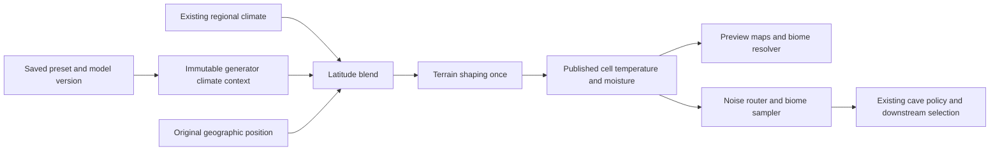

# Optional native latitude climate: research and recommendation

Research date: 2026-10-22. Status: research complete; implementation and runtime validation pending. Intended use: design a draft PR for Minecraft 1.21.1 FreeTerraForged (FTF).

The subsequent [custom-branch specification](../../features/native-latitude-climate/SPEC.md) is the implementation contract. This report remains supporting research; proposed choices here are superseded where the specification makes a different decision.

Scope update: the user chose temperature **and** independently controlled latitude moisture, with no rewrite of existing regional moisture or terrain shaping. Earlier temperature-first staging recommendations below are historical; the specification adds only the latitude targets/blends to the current climate pipeline.

Start here, then read [the proposed draft PR plan](DRAFT-PR-PLAN.md), [the source register](SOURCES.md), and [the independent mathematical probe](probe.py). The probe is research code, not a Minecraft implementation.

The follow-up [deep algorithm research](ALGORITHMS.md) compares temperature curves, interpolation, insolation/energy balance, coherent variation, moisture transport, ocean distance and rain-shadow approaches. It includes [reproducible experiments and figures](EXPERIMENTS.md) and [14 algorithm references](ALGORITHM-SOURCES.md). The scalar smoothstep proposal below is a baseline candidate; the final curve must pass the algorithm study's coverage and integration gates.

## Recommendation

Build a small native latitude model inside FTF, **off by default**, with explicit per-world settings and a versioned model identifier. Keep the existing climate path intact when disabled. Do not make Natural Temperature (NT) the engine behind the first native toggle. Consider an optional NT adapter separately if exact NT behavior is a requirement and a supported integration contract becomes available.

This recommendation assumes the first release targets **new worlds**, with existing TerraLatitude worlds retaining their existing generator. Exact TerraLatitude compatibility was posed as an optional scope question; no answer was available when this report was prepared. If exact continuity is the primary goal, retaining the pinned TerraLatitude/NT stack is the safer starting point, and compatibility becomes a separate first-class deliverable.

The main work is not inventing temperature mathematics. It is integrating climate consistently with FTF's cells, previews, presets, caches, terrain adjustments, and other mods. A dependency does not eliminate that work.

## Evidence and scope

The local code reviewed is `MuiGoku123432/FreeTerraForged` at `43244515ebf3d3aa9867aba97d8ec360faeabdae`, branch `1_21_1-unstable-custom`. This branch includes upstream plus custom work, including the proposed PR #301 raw-climate API. Findings about that API must not be presented as already available in upstream. The recorded upstream base is `22c2801b4772dbde04044ec80551e5bb89c845a1`.

External evidence includes pinned TerraLatitude source and design documents, NT's official project description and license, and official loader documentation. References use source IDs from [SOURCES.md](SOURCES.md). Facts, design proposals, and unverified expectations are distinguished below. No NT binary was decompiled or modified. No game was launched for this research.

## What FTF already provides

### Latitude-like temperature already exists

`LegacyTemperature.compute` uses a sine of scaled Z, a power/falloff transformation, and a mapping into 0–1. `ClimateModule` applies preset range/bias settings and coordinate warps around that noise. FTF therefore already has a periodic north–south temperature structure, although it lacks a simple user-facing equator/pole contract. [F1, F2]

The most economical native feature is an explicit geographic model alongside this legacy behavior. Replacing `LegacyTemperature` in place would risk changing existing worlds and serialized noise behavior. A new mode can reuse FTF's surrounding machinery without preserving NT's many modes.

### Cached cell climate is the useful integration point

`ClimateModule.apply` computes temperature and moisture, shapes them using terrain elevation, and writes `Cell.temperature` and `Cell.moisture` in Minecraft's signed climate units. `CellSampler` exposes these values through the noise router. Preview rendering, detail displays, and the preview biome resolver also consume cell climate. [F2–F5]

**Inference:** composing latitude before these final cell values are published offers a common source for generation and preview. Injecting only at `Climate.Sampler.sample` leaves cell readers outside the integration. It still takes tests to prove agreement through preview-specific policies and downstream decorators.

`Climate.apply` may perform a second climate evaluation using edge-displaced coordinates. `ClimateModule.apply` already receives both displaced and original coordinates. The new geographic field should use the original position, while existing regional sampling retains its displacement. Recompute from raw inputs on a second evaluation; do not cool the previous result a second time. [F2, F3]

### Settings ownership needs attention

Although `ClimateModule` receives `ClimateSettings` in its constructor, current altitude and moisture shaping reads `PresetManager.PM.climateSettings`. That global reference is a poor owner for concurrent world or preview calculations. A native profile should capture immutable owner-specific values. Moving existing behavior to snapshots should be a separable change with disabled-mode regressions; it must not be disguised as harmless arithmetic cleanup. [F2]

Preset codecs and `copy()` provide the natural place for latitude configuration. Preview request identity already fingerprints an encoded preset copy. Add the new fields to both serialization and copying, then verify export/reload and cache invalidation. The presence of a codec alone does not prove every world-save path persists the new values. [F6]

### Climate is not a weather or hydrology simulation

FTF's existing moisture shaping uses elevation-dependent boost and drying. Its `rainShadowStrength` does not calculate wind direction and an upwind mountain barrier; its coastal boost is not a measured distance to the ocean. A latitude feature should not advertise either as a new physical simulation. [F2]

Temperature and humidity affect biome selection. This proposal does not directly simulate seasons, rain events, crops, player temperature, or river discharge. Changes to chosen biomes can still affect surfaces, vegetation, features, and structures. Preserving terrain noise does not imply identical final chunks.

## What Natural Temperature would contribute

NT's official project page describes configurable latitude climates, several band/circular modes, zone settings, wave variation, looping, and optional underground variation. It lists 1.1.10 artifacts for Minecraft 1.21.1 on Fabric and NeoForge. Its ordinary configuration is shared between worlds, and changes affect subsequently generated chunks. The author also documents limitations in some advanced mode/coverage combinations. These are useful features, but they exceed the minimal native toggle. [N1]

The inspected public NT repository contains documentation/license material; it did not expose the calculator implementation or a documented stable integration API. This is a limitation of the inspected evidence, not a claim that collaboration with the author is impossible. TerraLatitude demonstrates that callable calculator classes exist. [N2, T2]

### TerraLatitude reveals the real integration cost

TerraLatitude 0.3.1-test targets a particular NeoForge/FTF/NT combination. Its adapter constructs NT temperature and humidity contexts as a pair. It snapshots settings, uses a scoped thread-local for redirected configuration reads, and redirects static zone fields in the calculator classes for advanced modes. It also validates sampler/world ownership. These are substantial responsibilities beyond calling a formula. [T1–T4]

Its documentation records an actual injection-order failure: NT could return before TerraLatitude ran. Explicit injector order 900 fixed the observed path; Mixin priority alone did not. Owner-run 0.2.1 transects matched temperature/humidity at 129 sampled positions, with cooling on 112 land samples. The 0.3.1 work has offline checks; the documentation still identifies runtime and performance work as pending. These are the project's reported observations, not tests rerun here. [T1]

TerraLatitude persists a world profile and protects it using seed/preset identity. It deliberately changes sampled biome climate without rewriting FTF's cached cells or preview. Its surface composition blends pre-altitude regional temperature with NT and then cools once; humidity blends NT with already terrain-shaped FTF moisture. A native pipeline that shapes blended moisture once is a different model. [T1, T3]

This does not mean TerraLatitude is a bad design. It solves an integration problem from outside FTF. Moving the ownership and composition inside FTF can remove some of those external workarounds.

### Licensing and maintenance boundary

FTF and TerraLatitude carry MIT licenses. NT's inspected custom license permits specified uses, including credited modpacks, and restricts modification, reverse engineering, and standalone redistribution without permission. Consequently, copying or porting NT's implementation into FTF is not the proposed route. Loading an independently installed dependency is a distinct design; any supported API use and invasive mixin approach should be clarified with the author before committing to it. This report does not determine the legal status of the existing addon. [F7, T5, N2]

Independent generic climate mathematics and FTF's own existing code are enough for the proposed native model. Native implementation should not be a transcription of NT calculations or its adapter's NT-specific coordinate contract.

## Options compared

| Criterion | Native FTF model | Optional NT engine | Native plus NT engines in first PR |
| --- | --- | --- | --- |
| No extra mod required | Yes | Only legacy mode works without NT | Native mode works without NT |
| Exact NT modes | No; deliberately smaller scope | Best route, still needs verified adapter parity | Possible, but two models to validate |
| Cached cells and preview | Fits existing FTF data flow | Requires new integration beyond current TerraLatitude | Must verify both paths |
| Per-world isolation | Explicit immutable profile | Snapshot or supported pure API needed | Both ownership contracts needed |
| Existing TerraLatitude continuity | Cannot assume it | Potentially achievable with pinned arithmetic/settings | Must keep a distinct legacy model |
| Update coupling | FTF and Minecraft | FTF, Minecraft, NT internals/API, loader hooks | Highest test and support burden |
| Algorithm control | Full control; our biome tuning responsibility | Author controls model evolution | Two sets of defaults and bug behavior |
| Licensing boundary | Own implementation within FTF | Clarify API/mixin permissions; no bundling assumption | Same dependency questions remain |
| First release effort | Moderate, integration dominates | Superficially shorter; robustness remains substantial | Largest and least focused |

These are qualitative engineering judgments, not measured development times or benchmark results. Native wins for a coherent FTF feature. NT wins when matching its exact patterns is more important than independence. Building both immediately makes review and world-compatibility testing harder without establishing the first model's quality.

## Proposed native model, independently designed

### Model and configuration

Use a new model identifier such as `ftf:latitude_v1` and a separate settings schema version. The identifier fixes the generator's mathematical meaning, not merely the JSON layout. Missing configuration means legacy behavior. Unknown enabled model versions must produce a clear error, not fall back silently.

Initial controls: enabled, equator Z in blocks, equator-to-pole distance in blocks, and temperature strength. Retain existing regional temperature and elevation controls. Start with latitude moisture strength zero; add a documented independent moisture curve only after temperature behavior is established. Configuration ranges and final defaults need visual/biome testing.

### Minimal temperature calculation

For original block position `(x,z)`, equator `e`, and positive pole distance `D`:

```text
u = clamp(abs(z - e) / D, 0, 1)
s = u*u*(3 - 2*u)
latitudeTemperature01 = 1 - s
target01 = applyExistingTemperatureRangeOnce(latitudeTemperature01)
mixed01 = regional01,                         if strength == 0
mixed01 = regional01 + strength*(target01-regional01), otherwise
final01 = existingElevationShaping(mixed01, terrainHeight, ownerSettings)
cell.temperature = final01*2 - 1
```

This smoothstep curve is a simple stylized world-generation proposal, not a physical temperature prediction. Climate units are not Celsius. `regional01` already includes existing range/bias settings; do not apply them again to the blended result. Apply the equivalent range mapping independently to the untransformed latitude target. Preserve the original operations on the disabled path.

Compared with linear interpolation, smoothstep has zero slope at equator and poles, avoiding slope corners where hemispheres meet or cold caps begin. A cosine curve is another viable smooth candidate, but adds no demonstrated benefit yet. The proposed polynomial is sufficient to test the feature. Piecewise climate-zone curves can follow if biome coverage proves inadequate.

At full latitude strength, small-scale temperature noise disappears unless explicitly reintroduced. At lower strength, existing regional variation remains. Do not add hidden randomness simply to make a screenshot look better. A later boundary-variation setting could use FTF noise with a separate seed derivation that does not consume the existing generation seed sequence.

### Geometry and infinite worlds

The first model has a warm equator, colder north/south, and cold climate beyond each pole distance. That produces large polar regions in an infinite world; the UI must explain this. A repeating mode is a separate option, not an unnoticed implementation detail.

An independently defined repeating latitude could use a triangular distance to the nearest equator with period `2D`, followed by the same smoothstep. Use mathematical floor-mod semantics at negative coordinates. The research probe checks this alternative, but it is deferred from the first PR to keep the saved model small.

Use adequate precision for subtraction/division and avoid integer overflow. Current climate paths accept floats, so promoting an already rounded coordinate to double cannot restore lost precision near world limits. Trace the coordinate entry point before promising single-block geographic precision at extreme coordinates. Test negative positions and Minecraft's large-coordinate range explicitly.

### Moisture and elevation

Latitude temperature alone does not guarantee plausible deserts or forests. Biomes depend on the paired humidity and other climate coordinates, along with the active biome catalog. For an eventual moisture model, use a separately tunable continuous curve (for example humid equator, dry subtropics, wetter midlatitudes), then blend **raw** regional moisture and apply FTF moisture shaping once. Do not describe this stylized curve as a weather simulation.

Do not apply temperature cooling twice, cool oceans based on seabed depth, or use player height for biome generation. Preserve the existing terrain-height gate and define rounding/quantization deliberately. Do not add TerraLatitude's five-tap smoothing to an already continuous native field without evidence that it improves biome layout enough to justify the cost.

### Ownership and order



This is the proposed surface-climate data flow, not a complete runtime call graph. Existing cave protection can change depth after sampling. Changing surface temperature/humidity may also change cave biome choice; unchanged cave biomes cannot be promised. Non-FTF generators and unrelated dimensions must retain their existing behavior. [F4, F8]

Keep raw-regional access explicitly raw. PR #301 consumers must not suddenly receive already latitude-composed or elevation-shaped values under the same API contract. If a composed query API is needed, name and version it separately.

## If we choose optional NT instead

The desirable dependency contract is a pure evaluation entry point receiving immutable settings, world seed, coordinates, and regional inputs, returning paired temperature/humidity. It needs an explicit opt-out for NT's own sampler transformation on the FTF owners served by the adapter. Without that ownership contract, calling NT internally and allowing its sampler hook to run again can double-transform climate.

An adapter should be isolated from common class loading, activated only for supported installed versions, and tested with NT absent. NeoForge supports optional dependencies that validate compatibility when present. Fabric's `suggests` is metadata, while `recommends` only warns on mismatch; neither is a substitute for adapter runtime version checks. Mod loading order is not evidence of sampler injection order. [L1, L2]

Do not silently select an engine based on which mods happen to be installed. Persist the chosen engine and settings. If an existing world requires NT and it is absent or unsupported, stop before generation with an actionable explanation. Never automatically replace its engine with native latitude.

A supported NT route would also require artifact/version pinning, per-world seed/config isolation, preview participation, safe thread-local cleanup if that mechanism remains, and both loader test matrices. Do not shade or redistribute its JAR without appropriate permission. A separately installed adapter can be a reasonable later package, keeping NT-specific compatibility code out of the core model.

## Existing worlds and coexistence

Legacy FTF worlds should decode as disabled and retain their established output. Existing TerraLatitude worlds should retain their saved engine and dependencies. Enabling a new model affects newly generated chunks; it does not rewrite stored biomes or erase old/new borders.

Exact TerraLatitude migration is especially sensitive to arithmetic. Its published synthetic altitude comparison found 69,531 differing quantized results among 1,286,285 supplied cases when comparing its retained double arithmetic with the native float sequence; differences were at most one quantization unit. This is supplied-input evidence, not proof of differences at those frequencies in actual terrain. It is enough to reject a claim of automatic bit-for-bit interchangeability. [T6]

For native-enabled worlds, NT/TerraLatitude coexistence must have an explicit tested ownership mechanism. Until one exists, detect the conflicting combination before new chunks are generated and provide a clear configuration error. Do not disable NT globally, silently stack two engines, or reject all installations regardless of whether the native mode is active. Legacy mode should preserve existing integration behavior.

A future migration tool could read an old profile and suggest visually similar settings, but it must label the result approximate, use a new model version, and operate on a backup/new comparison world. Exact parity would require retaining the old arithmetic and dependency behavior under a separate model, not merely copying a few settings.

## Remaining uncertainty and research result

The code and integration evidence support native-first. They do not establish final biome coverage, runtime performance, full-pack compatibility, or save/reload correctness. Those require the experiments in the draft plan. A supported pure NT API and explicit per-sampler opt-out could materially improve the dependency option; no such contract was established by this research.

The included Python probe checks only the independently proposed scalar geometry and interpolation. It passed 36,664 assertions covering bounds, hemisphere symmetry, monotonicity, boundary continuity, an optional repeating geometry, interpolation and rejected invalid inputs. Its output is saved in [probe-results.json](probe-results.json). It cannot validate Java floating-point parity, FTF noise seeds, Minecraft quantization, biome choice, mixin execution, or chunk generation.

Reproduce from the repository root:

```sh
python3 .planning/research/native-latitude-climate/probe.py
```
